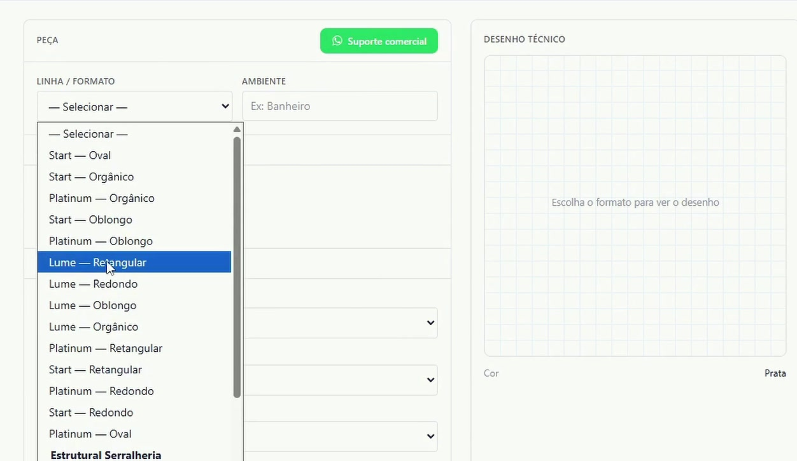
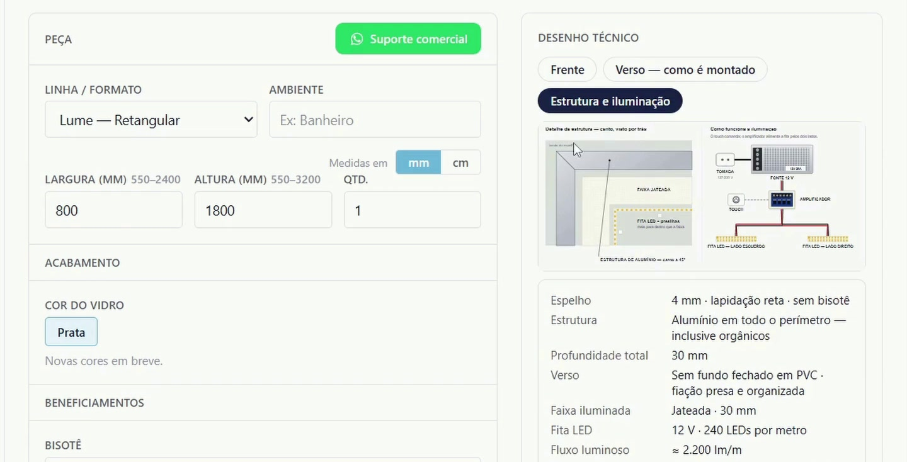
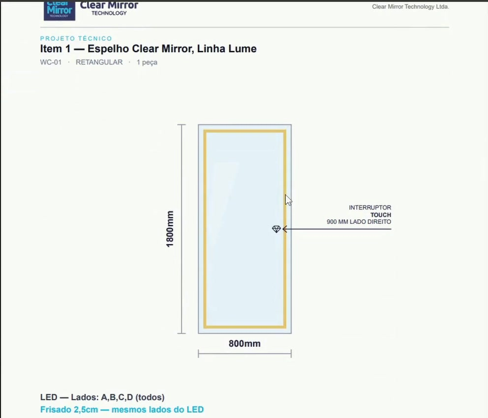

# Portal Clear Mirror — Sistema de Orçamentos e Pedidos

**Clear Mirror Technology** · Sinop, Mato Grosso, Brasil

| Campo | Informação |
|---|---|
| **Desenvolvimento** | Clear Mirror Technology |
| **Autor** | Adevarley Borges — fundador, inventor e desenvolvedor autodidata |
| **Local** | Sinop, Mato Grosso, Brasil |
| **Estágio** | **Em operação** — https://portal.clearmirrortechnology.com |
| **Registro público** | versão 1.0 (data da publicação deste registro: novembro de 2026) |

## Descrição

O Portal Clear Mirror é uma plataforma web desenvolvida pela Clear Mirror Technology para transformar a especificação
de um espelho iluminado sob medida em orçamento, projeto técnico e pedido de fabricação, sem visita presencial.

## Finalidade

Espelhos iluminados sob medida combinam linha, formato, medidas, acabamento, iluminação e acionamento. Sem um fluxo
único, cada combinação exige troca de mensagens, desenho e conferência a cada pedido. O Portal reúne essas decisões em
um só lugar, mostra o resultado na hora e leva para a fábrica uma especificação única de cada peça.

## Aplicação

1. **Configuração** — linha (Start, Platinum, Lume), formato (retangular, redondo, oval, oblongo, orgânico), largura e
   altura dentro dos limites de cada linha, acabamento, beneficiamentos e temperatura da luz.
2. **Desenho técnico gerado na hora** — vistas de frente, verso (como é montado) e estrutura e iluminação, atualizadas a
   cada mudança, com a ficha técnica da peça.
3. **Orçamento e projeto técnico em PDF** — cada item sai com o desenho cotado e a posição do acionamento.
4. **Pedido** — a especificação segue para a fábrica, peça por peça.

**Quem usa:** clientes finais, lojistas e vidraceiros parceiros configuram e pedem; arquitetos e designers de interiores
usam o desenho técnico para especificar soluções Clear Mirror em seus projetos. O Portal atende clientes em nove estados
brasileiros e no Distrito Federal.

## Evidências

| Imagem | O que mostra |
|---|---|
|  | Escolha de linha e formato da peça |
|  | Desenho técnico e ficha da peça gerados na hora |
|  | Projeto técnico em PDF, com medidas e acionamento |

Imagens capturadas da demonstração pública do Portal (configuração de exemplo, sem dados de clientes).
Vídeo de demonstração: https://www.instagram.com/reel/DeNPxUxM3jv/

## O que este registro não contém

Este é um registro descritivo. Código-fonte, arquitetura interna, banco de dados, integrações, infraestrutura e dados de
clientes são privados e não fazem parte desta publicação. Este registro não é patente, certificado nem validação
oficial da tecnologia.

## Referências

- Clear Mirror Technology: https://clearmirrortechnology.com
- Portal: https://portal.clearmirrortechnology.com
- Instagram: https://www.instagram.com/clearmirrorbr · YouTube: https://www.youtube.com/@clearmirrorbr
- Outros registros públicos da Clear Mirror Technology: https://github.com/clear-mirror-technology

## Como citar

Borges, Adevarley. *Portal Clear Mirror — Sistema de Orçamentos e Pedidos*. Clear Mirror Technology, Sinop (MT), 2026.
Registro público versão 1.0.

## Direitos

© 2026 Clear Mirror Technology. Todos os direitos reservados — ver [LICENSE.md](LICENSE.md).
